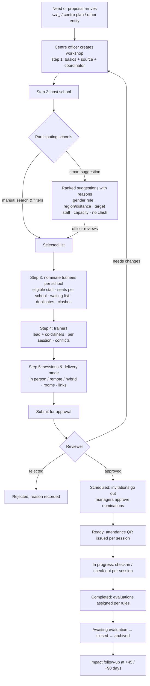

# مجتمعات التعلّم المهني (PLC) — Analysis and design for review

Date: 2026-10-15 · Branch: `claude/intelligent-brahmagupta-7pysbz` · Status: **analysis and design only; nothing implemented**

This document answers the brief's first instruction: inspect the current project, then present the two scenario flows, the data model, the permission matrix, the workshop states, the school-selection rules, the attendance design, the survey-assignment rules and the implementation and test plan. Every statement about the existing system was read in the repository. Implementation starts only after your review, in small phases, each with tests and a report.

---

## 1. What already exists (reuse first)

The brief's "workshop" is, in TEDC's terms, a **programme with one training group and its sessions**. Most of the operational machinery the brief asks for is already there and must be reused, not rebuilt.

| Brief requirement | Existing asset | State |
|---|---|---|
| Workshop with title, objectives, delivery mode, capacity, dates | `programs` (delivery_mode `in_person/online/hybrid`, capacity, objectives, audience, `owner_type/owner_school_id`, `approval_status`, `source_type`, `coordinator_id`, `remote`, `external_platform`) | ✓ reuse |
| Sessions with their own time, room, trainer, online link | `program_sessions` (starts/ends, `training_room_id`, `trainer_id`, `online_url`, `location_text`, status, `qr_secret`, `training_group_id`) | ✓ reuse |
| School internal workshop with review and approval | `InternalWorkshopService` + `InternalWorkshopController` (`/admin/internal-workshops`): a school submits a programme owned by the school, approvers with `workshops.approve` decide, staff of that school are registered | ✓ reuse and extend (today: one step pending → approved/rejected, no "needs changes", no sessions wizard) |
| Trainees: nomination, waiting list, duplicates, time conflicts | `registrations` (pending_manager, pending, approved, waitlisted, rejected, withdrawn, cancelled, completed) + `RegistrationService` + `ConflictService` (overlaps with other registrations, repeats) | ✓ reuse; add the brief's "معتذر" (declined) state |
| Trainers: several per workshop, lead and co-trainers, proposal and approval, conflicts | `group_trainers` (role, hours, proposed → approved/rejected, external approval reference) + `TrainerAssignmentService` + `TrainerService::assertAssignable` (double booking) + `TrainerService::suggest` | ✓ reuse; sessions hold one trainer today, so a session-trainer link is added |
| Rooms, capacity, double booking, alternatives | `training_rooms`, `room_bookings`, `RoomService` (`conflicts`, `assertBookable`, `suggest`), effective capacity | ✓ reuse |
| Training calendar, closed days, approvals for closed days | `CalendarService` + `TrainingCalendar.tsx` (381 lines) | ✓ reuse; add school/region/trainer/mode filters and a conflicts panel |
| QR attendance | `AttendanceService`: a per-session rotating HMAC token (`TEDC.<session>.<window>.<signature>`, 2-window tolerance, no personal data), first scan = check-in, second = check-out, geofence option, `attendance_attempts` log of rejected scans, manual marking inside a window with actor; personal QR scanned by staff; trainer attendance; tablet signature; remote join/leave | ✓ reuse; add separate check-in / check-out operations, revocation, per-session windows, `left_early`, record locking |
| Attendance statuses and policy | `attendance.status` present/late/absent/excused; late after `late_after_minutes` (15); scan `intent` check_in / check_out already accepted; `AttendanceSettings` (geofence, windows, manual window, absence thresholds, excuse counting) | ✓ reuse; add `left_early` and an early-leave threshold |
| Attendance reports | `AttendanceExport` (Excel, PDF) | ✓ reuse |
| Evaluation forms by kind, assignment, timing, reminders, impact | Evaluation suite: forms `satisfaction, impact_trainee, impact_manager, trainer_reflection, planning_evaluation, supervisor_feedback, specialist_feedback, custom`, `EvaluationService::assign / assignForGroup / assignManual / dispatchManagerImpact`, hourly job, 45/90-day impact, reminders, expiry, threshold hiding, alerts | ✓ reuse; add session- and trainer-level targets and the suggestion rules |
| Any other survey type | Survey Studio v2 engine (Gate 2, this week) | ✓ reuse for custom instruments |
| Notifications, bilingual, delivery status, retry | `NotificationService` + `NotificationCatalog` (editable templates) + `notification_deliveries` (status, attempts, failed_reason, provider id) | ✓ reuse; add PLC event types |
| Roles, scopes, record-level grants | RBAC + `AccessScope` (ministry / school group / school / department) + `ProgramGrantService` (per-programme abilities such as `attendance.mark`) | ✓ reuse |
| Audit | `audit_logs` + `Auditable` + SIEM outbox | ✓ reuse |
| Schools directory with official type, gender, stage, region, district, coordinates | `schools` (`type` government/private/community/international, `gender` boys/girls/mixed in the data, `stage`, `region` 8 regions, `district`, `latitude/longitude`, `moe_no`, `source`) | ✓ reuse; **coordinates are empty in the sample data** (migration `002800_clear_sample_school_positions`), so distance must degrade to region/district |
| Communities (مجتمعات) as social spaces | `spaces` (type, subject, visibility, join policy), members with roles, posts, polls, questions, files, events with RSVP, behind the `plc` flag | ◐ this is the discussion layer, not the organisational PLC frame the brief describes |
| Needs from راصد | **No integration exists.** The word appears only in the privacy register. Needs today come from the needs cycle (`program_proposals`, `institutional_requests`, `training_needs`, needs surveys) | ✗ manual, documented entry with a reference field (as the brief allows); importer interface reserved |
| Exports PDF / Excel / CSV | mpdf, PhpSpreadsheet, report builder | ✓ reuse |
| Mobile | Flutter screens for attendance scan, community, programmes, evaluation | ✓ reuse; scan screen learns the new operations |

**Conclusion of the inspection**: the PLC module is an orchestration layer over the programme engine, plus five things that genuinely do not exist: the PLC community frame across schools, the workshop source model (راصد / centre / other entity / school), participating-school selection with compatibility and proximity rules, a configurable workshop lifecycle with "needs changes" and scheduling gates, and the evaluation suggestion rules. Everything else is extension, not creation.

Inconsistency found: one seeder writes `gender => 'female'` for a school while the data uses `boys/girls/mixed`. Phase 1 normalises the value set and validates it.

## 2. Scenario flows

### 2.1 Scenario 1 — a shared PLC across several schools



### 2.2 Scenario 2 — an internal workshop in one school

```mermaid
flowchart TD
  A[School coordinator opens "ورشة داخلية"] --> B[Same wizard, internal preset:<br/>host = own school · participants = own staff · source · trainer inside or outside]
  B --> C[Save draft or submit]
  C --> D{Review path per policy<br/>school principal → centre approver}
  D -->|needs changes| B
  D -->|rejected| X[Rejected with reason]
  D -->|approved| E[Scheduled: sessions confirmed, invitations to own staff]
  E --> F[Ready → in progress → completed]
  F --> G[Evaluations by rules → closed]
  B -. widen scope .-> H{Add other schools?}
  H -->|needs approval| D
```

Both scenarios run on one engine; the internal scenario is a **preset** (host fixed to the requester's school, participant scope limited to that school, a shorter approval path), never a second code path.

## 3. Data model (new and extended)

New tables (all UUID keys, foreign keys, indexes):

- `plc_communities` — id, code, title_ar/en, description, domain (المجال), status (active/archived), lead_user_id, host_school_id (nullable), space_id (nullable link to a discussion space), settings, created_by, timestamps. **The PLC frame.**
- `plc_community_schools` — community_id, school_id, role (member/host), joined_at.
- `plc_needs` — id, source (`rased` / `centre` / `entity` / `school`), reference_no, title, description, domain, target_audience, received_at, review_status (new/under_review/converted/declined), source_url, notes, school_ids json, entity_name, proposer_name, justification, expected_outcomes, attachments (file ids), created_by. **One record per incoming need or proposal; a need can be converted to one or more workshops.**
- `plc_workshops` — program_id (PK/FK → programs), community_id (nullable), need_id (nullable), source (required, frozen after approval), source_ref, organiser (`centre` / `entity:<name>`), coordinator_user_id, priority, expected_participants, prerequisites, outcomes, scenario (`shared` / `internal`), host_school_id, workflow_state, state_changed_at, approval_path json (the configured steps), decision_note, attachments. **PLC-specific fields without widening `programs`.**
- `plc_workshop_schools` — program_id, school_id, role (host/participant), seats (nullable), status (suggested/selected/excluded/approved), suggestion_reasons json, distance_km (nullable, only when computed from official coordinates), excluded_reason, decided_by.
- `plc_session_trainers` — program_session_id, trainer_id, role (lead/co), minutes, status (planned/confirmed/replaced), note. (Sessions keep `trainer_id` as the lead for backward compatibility.)
- `plc_decisions` — id, subject_type/subject_id (workshop, school choice, trainer change, exception…), decision, reason, by, at. **The decision log the brief asks for.**
- `plc_settings` (site setting, not a table) — gender policy, max distance km, region rule, stage rule, approval paths per source and scenario, attendance policy (late minutes, early-leave minutes), evaluation rules, retention for attachments.

Extensions to existing tables:

- `registrations`: status `declined` (معتذر) + `decline_reason`; `nomination_source` already covered by `source`.
- `attendance`: `channel` (`in_person` / `remote`) for hybrid sessions; `status` gains `left_early`; `locked_at`, `locked_by`, `correction_reason`.
- `program_sessions`: `qr_version` (revocation), `delivery_mode` per session (nullable, inherits the programme's), `check_in_window`, `check_out_window` (minutes, nullable → policy default), `platform` (remote).
- `evaluation_assignments`: `program_session_id` (nullable), `trainer_id` (nullable), `rule_key` (why it was assigned) — enables session and per-trainer evaluations and the dedupe rule (unique on form + respondent + session/trainer target).
- `programs`: `kind` value `plc_workshop` (column exists).

Nothing is deleted or renamed. Existing internal workshops are migrated into `plc_workshops` rows with `scenario = internal` (reversible).

## 4. Workshop states and transitions (server-side)

`plc_workshops.workflow_state`, checked by a state machine on the server; every transition records actor, time, reason (when required) in `plc_decisions` and the audit log.

| State (brief) | Key | Enters when | Leaves to |
|---|---|---|---|
| مسودة | draft | created | submitted, cancelled |
| مقترح مقدم / بانتظار المراجعة | submitted | submit (needs ≥1 session plan or a proposed date, a source, a host) | needs_changes, approved, rejected |
| بحاجة إلى تعديل | needs_changes | reviewer asks for changes (reason required) | submitted, cancelled |
| معتمدة | approved | the configured path completed; source frozen | scheduled, cancelled |
| مجدولة | scheduled | every session has time + room-or-link; invitations sent | ready, needs_changes (with notification to those invited) |
| جاهزة للتنفيذ | ready | QR issued for the first session (or T-24h) | in_progress |
| جارية | in_progress | first session starts | completed, cancelled (reason, future sessions cancelled) |
| مكتملة | completed | last session ends | awaiting_evaluation |
| بانتظار استكمال التقييم | awaiting_evaluation | mandatory evaluations assigned | closed (when mandatory ones are complete or an exception is recorded) |
| مغلقة | closed | report issued | archived |
| مؤرشفة | archived | retention | — |
| مرفوضة / ملغاة | rejected / cancelled | decision | — |

Rules enforced on the server: no execution before `approved` unless the policy flag `allow_unapproved_execution` is on for the scenario; no close before mandatory requirements or a documented exception; time or venue changes after invitations create a new "schedule change" decision and notify affected people; cancelling cancels future sessions, pending invitations and unsent evaluations and keeps attendance and responses already recorded; editing never deletes attendance or responses.

The existing `programs.status` and `training_groups.status` are kept in sync by the state machine (e.g. approved → `registration_open`, in_progress → `in_progress`), so every existing screen keeps working.

## 5. School selection rules

- **Official classification only**: `schools.gender`, `type`, `stage`, `region`, `district`, `latitude/longitude`; never the name.
- **Gender policy** (configurable in PLC settings): `strict` (host and participants share the gender category; `mixed` matches both), `allow_with_exception` (an incompatible choice needs an exception recorded in `plc_decisions` and approved by a role with `plc.exceptions`), `open`. Default proposed: `strict` for `boys`/`girls` targeted workshops, mixed schools always eligible.
- **Proximity**: when both schools have official coordinates, Haversine distance, sorted ascending, cut at the configurable maximum (default 25 km). When either lacks coordinates, the engine falls back to same `district`, then same `region`, and the UI shows "within the same region" with **no distance and no travel time** (the brief forbids invented values).
- **Target staff**: count of active employees in the school matching the workshop's target job titles / stages / specialisations (`SurveyAudience::query` is reused for this count).
- **Capacity**: remaining seats of the workshop against the school's eligible staff; seats per school optional.
- **Availability**: schools whose staff already sit in a clashing workshop at the same time are flagged, not hidden.
- **Transparency**: every suggestion carries its reasons (`gender_match`, `same_district`, `distance_km`, `eligible_staff: n`, `clash: n`) and the excluded list shows why (`gender_mismatch`, `beyond_max_distance`, `no_eligible_staff`).
- Suggestions never select or invite by themselves; the officer confirms.

## 6. Attendance design (check-in and check-out QR)

Builds on the existing rotating token. New payload: `TEDC2.<session>.<op>.<version>.<window>.<signature>` where `op` is `in` or `out`, `version` is the session's `qr_version` (incremented on revoke → every older code becomes invalid at once), `window` the rotation slot, and the signature an HMAC over all fields with the session secret. No employee data in the code.

Rules (all server-side):
- A code works only for its own session and operation and only inside the operation's window (check-in from `starts_at − check_in_window` to a configurable cut-off; check-out from `ends_at − check_out_window` to `ends_at + grace`).
- Check-in twice = `already_present` (logged in `attendance_attempts`, not counted); check-out before check-in refused; a code of another session refused with `wrong_session`.
- Status is derived by policy: `present`, `late` (check-in after `starts_at + late_minutes`), `left_early` (check-out before `ends_at − early_leave_minutes`), `absent` (no check-in by close), `excused` (leave/excuse records, existing).
- Hybrid: the participant's channel is recorded (`in_person` by QR at the venue, `remote` by the existing remote join/leave with the policy's verification); the same person cannot hold both channels for one session.
- Identity: the scan happens inside the signed-in app or portal (existing JWT), optionally with the geofence and the staff-scan path; the brief's "QR alone is not proof" is honoured and the verification level is shown on the record.
- Corrections: manual marking after the window needs `attendance.manage`, a reason, and is audited; once a session's attendance is locked by the coordinator (`locked_at`), only `plc.exceptions` can change it, with a reason.
- Live roster for authorised staff (existing roster endpoint, extended with channel and status); printable and exportable report (existing `AttendanceExport`).
- Offline / network loss: the app queues the scan with its timestamp and the token; the server accepts a queued token only if its window was valid at the queued time and the session is still open (documented limit: at most the rotation tolerance).

## 7. Survey assignment rules

Reuses the evaluation suite's forms and assignment engine, plus Survey Studio v2 for custom instruments.

Suggestion engine (rule table, configurable in PLC settings; each suggestion shows its reason):

| Instrument | Suggested when | Timing (configurable) | Target |
|---|---|---|---|
| Workshop evaluation (satisfaction) | always | end of last session | trainees |
| Trainer evaluation | ≥1 trainer; one per trainer | end of the trainer's last session | trainees |
| Session evaluation | multi-session workshop and policy on | end of each session | trainees of that session |
| Programme / community evaluation | workshop belongs to a community | end of workshop | trainees + coordinators |
| Impact | policy on (default on for راصد-sourced workshops) | +45 days (+90 optional) | trainees |
| Supervisor / manager follow-up | impact on | +60 days | managers of trainees |
| Pre / post | policy per workshop | before first session / after last | trainees |

Guarantees: no assignment before `scheduled`; nothing is sent from a draft; one assignment per (form, respondent, session or trainer target); sending is recorded with the delivery status from `notification_deliveries` and never reported as sent without it; the tracking view shows assigned, targeted, opened (when the client reports it), completed, response rate, overdue, pending send, impact due.

## 8. Permission matrix (new `plc.*` family, applied with existing scopes and record grants)

| Permission | System admin | Centre officer | PLC lead | School principal | School training coordinator | Trainer | Trainee | Analyst | Reviewer / approver |
|---|---|---|---|---|---|---|---|---|---|
| plc.view (own scope) | ✓ | ✓ | ✓ | ✓ | ✓ | own | own | ✓ | ✓ |
| plc.manage (create shared workshops, select schools) | ✓ | ✓ | community scope | – | – | – | – | – | – |
| plc.community.manage | ✓ | ✓ | own | – | – | – | – | – | – |
| plc.internal.submit (school internal request) | ✓ | ✓ | – | ✓ | ✓ | – | – | – | – |
| plc.nominate (trainees) | ✓ | ✓ | community | own school | own school | – | – | – | – |
| plc.trainers.assign | ✓ | ✓ | community | – | – | – | – | – | – |
| plc.approve (per configured step) | ✓ | step | – | school step | – | – | – | – | ✓ |
| plc.exceptions (gender, locked attendance, unapproved execution) | ✓ | ✓ | – | – | – | – | – | – | ✓ |
| plc.attendance.manage | ✓ | ✓ | community | own school | own school | own sessions (grant) | – | – | – |
| plc.evaluations.manage | ✓ | ✓ | community | – | own school (view) | – | – | – | – |
| plc.reports | ✓ | ✓ | community | own school | own school | – | – | ✓ | ✓ |
| plc.settings | ✓ | – | – | – | – | – | – | – | – |

Existing roles mapped: super admin and centre admin (`*`), coordinator = centre officer, training head = reviewer/approver, school admin = principal, academic deputy (مسؤول التطوير المهني) = school training coordinator, trainer, employee = trainee, centre leadership / executive = analyst. "PLC lead" is a record-level grant on a community, not a new role. Final permissions are computed as the union of granted keys intersected with the active role's scope, never widened by holding several roles. Every route checks the scope on the server (`AccessScope`), so changing an id in a URL to another school's record returns 403.

## 9. Implementation plan (phases, each with tests and a report)

| Phase | Scope | Screens delivered | Tests |
|---|---|---|---|
| P1 Foundation | migrations, settings, `plc.*` permissions, state machine, sources and needs register (manual راصد entry), workshop create/edit API (multi-step, drafts), internal workshops migrated onto the engine | PLC dashboard shell, needs register, workshop wizard steps 1 and basics, lists | state transitions, source freezing, scope isolation, internal request path |
| P2 Schools | host selection, manual search and filters, compatibility rules, proximity engine with graceful degradation, seats per school, excluded list with reasons | host and participating-school steps | gender rule, distance vs region fallback, exclusions |
| P3 People | trainee nomination on `registrations` (+ declined), duplicates, clashes, waiting list, per-school seats; trainers lead/co per session, conflicts, change after approval with notification | trainee and trainer steps, nominations review | duplicates, clashes, capacity, trainer double booking, change after approval |
| P4 Scheduling | sessions per delivery mode, rooms, protected remote links, hybrid; calendar filters, conflicts panel, alternative slots (never auto-applied); change notifications | scheduling and calendar, workshop detail, sessions | room clash, closed days, schedule change after invitations |
| P5 Attendance | check-in / check-out codes, revocation, windows, statuses incl. left_early, hybrid channels, corrections and locking, live roster, report; mobile scan update | attendance screen, QR screen | expired code, wrong session, double scan, locked record, offline queue |
| P6 Evaluation | suggestion rules, timing, session and trainer targets, dedupe, tracking, impact follow-ups | evaluations and impact screens | rules per source and mode, no duplicate assignment, send failure shown |
| P7 Reporting | dashboard with real counts, filters, PDF/Excel/CSV, identical figures across views | dashboard, reports, settings and compatibility rules | numbers reconcile with the database |
| P8 Smart assistants | school and trainee suggestion explanations, planning assistant checklist, completion tracker, decision log views, feedback themes (AI opt-in only), impact linking | assistant panels inside existing screens | every suggestion is advisory; no auto decisions |

Each phase ends with: files changed, migrations, tests run with actual results, security-sensitive changes, known defects, what needs a decision or an integration, exact next step.

## 10. Decisions that need a human before P1

1. **Community frame**: a new organisational entity `plc_communities` linked optionally to a discussion space (recommended), or reuse the social `spaces` table as the community itself.
2. **Gender policy default**: `strict` with documented exceptions (recommended), or `open`.
3. **Proximity**: maximum distance 25 km when coordinates exist (recommended); whether the Ministry will supply official school coordinates (today the sample positions are deliberately empty).
4. **School training coordinator**: map to the existing "مسؤول التطوير المهني (النائب الأكاديمي)" role (recommended) or create a new role.
5. **Approval paths**: internal workshop = principal → centre approver; shared workshop = centre officer → training head (recommended defaults, both configurable).
6. **Geofence for PLC attendance**: off by default, per workshop opt-in (recommended), or on.
7. **Remote attendance proof**: join/leave timestamps with the existing policy (recommended) or Teams attendance records when the tenant is connected.
8. **راصد**: manual entry with reference number now (the only honest option); confirm whether an export file format from راصد exists to build an importer later.
9. **External AI for feedback themes**: opt-in per workshop on anonymised text only, as approved for Survey Studio (recommended).
10. **Attachment retention**: 36 months after close (recommended, same as survey answers).

## 11. Exact next step

On your approval of §§2–9 and answers to §10 (recommendations apply to anything left unanswered), P1 starts on this branch behind a feature flag `plc_workshops`, with its report in `docs/plc/01-phase1-foundation.md`.
