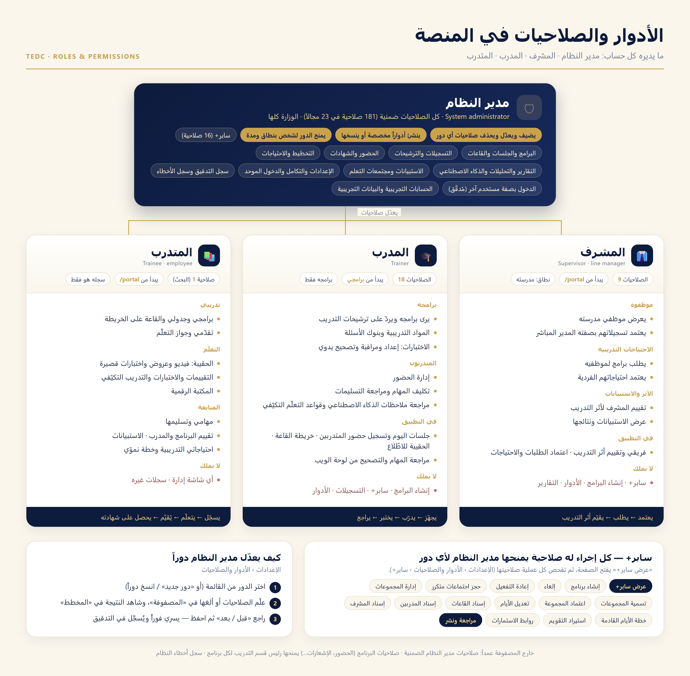
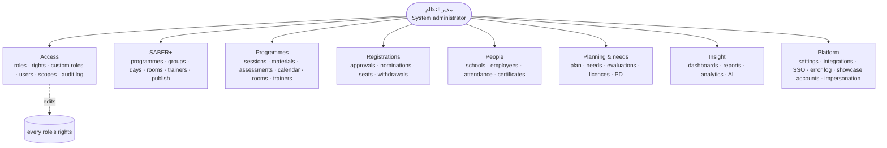
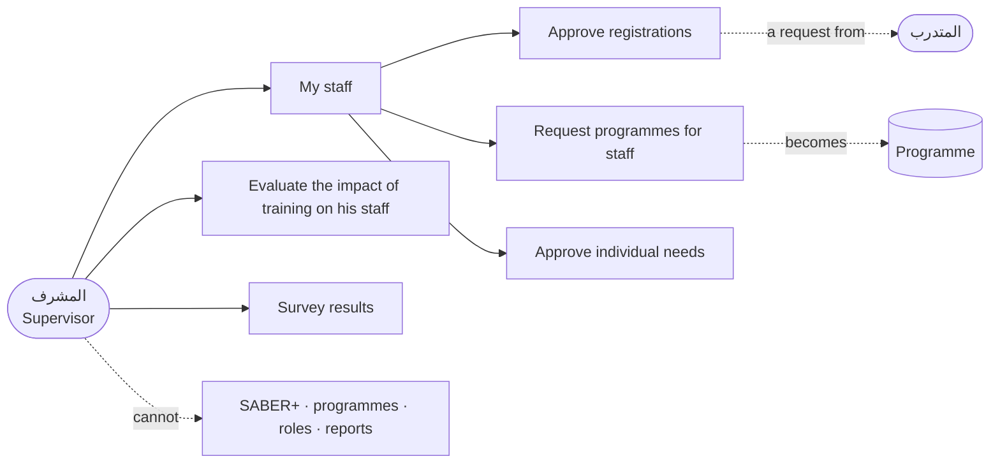
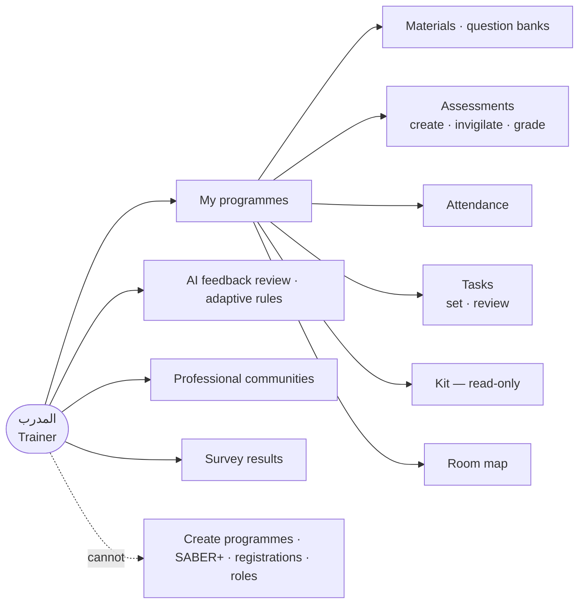
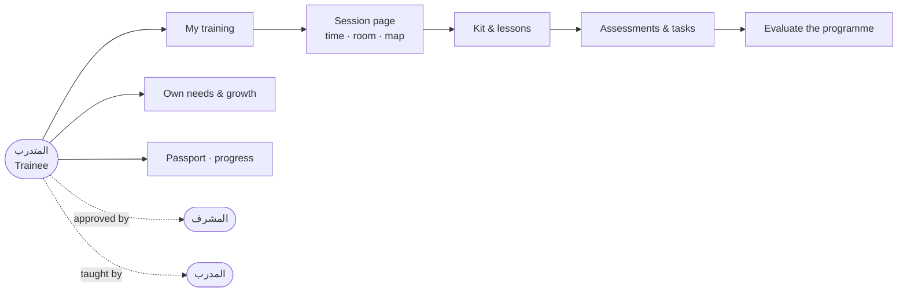
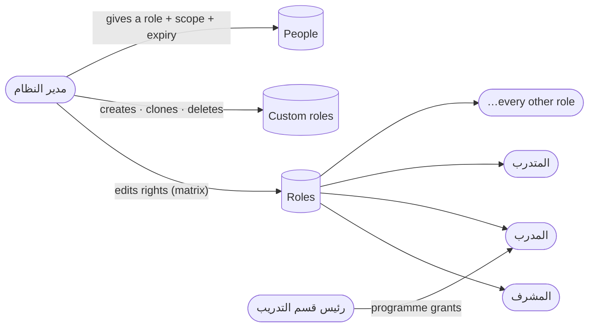

# Roles — what each showcase account can manage

The four showcase accounts (Settings → Showcase accounts) each hold one role. This page says what that role can do, and how the system administrator changes it.

| Account (Arabic) | Role (slug) | Lands on | Rights in the catalogue |
|---|---|---|---|
| مدير النظام | `super_admin` | `/admin` | all — implicit, cannot be edited |
| المشرف | `supervisor` (+ `employee`) | `/portal` | 24 |
| المدرب | `trainer` (+ `employee`) | `/admin/programs` | 18 |
| المتدرب | `employee` | `/portal` | 1 — the rest is *own-record* self-service |

> **Supervisor vs training supervisor.** المشرف (`supervisor`) is the school/department line manager who approves his own staff's training. مشرف التدريب (`program_coordinator`) is a centre role that runs programmes. The showcase "المشرف" is the first. **Since 2026-11-22**, by decision of the centre, المشرف takes the charter of مشرف التدريب: he reads that text on «صلاحياتي ومسؤولياتي» and holds the 15 rights it rests on, which are rights of the centre and not limited to his school (`docs/roles-charter.md`). He still cannot edit programmes or reach the administration of the system.

A *right* is a row of `RolePermissionSeeder::PERMISSIONS` (181 of them, in 23 areas). A route checks it with `permission:<slug>`; the web and the app hide what the signed-in user lacks. The system administrator is the only role that passes every check without holding the rights.

## How the system administrator changes any role

**Settings → Roles & permissions** (`/admin/settings?tab=roles`).

- **Edit** — pick a role (system roles included, except the system administrator's own), tick or untick rights in the **Matrix** tab, review the *before / after* list, save. Takes effect on the holder's next request. Audited (`permissions_changed`).
- **What the holders see** (since 2026-11-24) — a page that is opened by a right of its own appears in the side menu of **whoever holds that right, in every role and for every account**. This matters for the two roles whose home is the portal («مشرف», «موظف», and any custom role landing on `/portal`): their menu used to be a fixed list, so a right given to them opened the page but left no button to reach it. Now the portal menu ends with those pages (under «الإشراف» for a supervisor, «صفحات العمل» for the others); the rule is one function, `menuOfRole` in `web/src/components/admin/menuCatalog.ts`, with nothing written per role. Somebody who is already signed in gets the change without signing in again: the page asks for its rights again whenever its tab is looked at (at most every 20 seconds) and every five minutes while it stays in front (`web/src/lib/accessSync.ts`).
- **A person with several roles sees the rights of the role they are working in only.** A right given to «مشرف» does not show while the same person works as «موظف».
- **The page goes with its actions** — in an area whose only door is its "view" right (worked out from the menu by `onlyDoors`; today `saber.view`, `programs.view`, `live_training.view`, `surveys.view`, `gaps.view`, `plans.view`, `calendar.view`, `certificates.view`, `kpi.view`, `orders.view`, `schools.view`, `audit.view`), ticking an action ticks the page right with it and says so, since the action is no use without the page; it can be unticked, and a role left with actions but no page gets a warning with a one-tap fix. An area with another door (`analytics.executive`, `kits.manage`, `registrations.*`, `employees.manage`) is left alone, so nothing opens that nobody chose.
- **Check it for one person** — Users → the person → **«ما يراه»**, or **Employees → press the employee → «ما يراه»** in the side panel (the same content; the open employee and view are part of the address, `/admin/employees?employee=<id>&view=access`, so the administrator comes back to it after visiting the account) (`GET /admin/users/{user}/access`, `users.manage`): their position (job title, school, department), each role they hold with where it starts, the pages of its menu (worked out by the same `menuOfRole`) and its rights by area. From there the system administrator **opens the account in the role being looked at** («الدخول بحسابه بدور …») to see it exactly as the person does: one hour, a bar across the top with the way back, the start and the end audited (`impersonation_started` / `impersonation_ended`). The account opens in that role for this browser tab only; the role the person last chose for themselves is not changed. On a live system this tool is switched off until the system administrator switches it on in Settings → Features with a reason; while it is off the window says so and leads to the switch.
- **See** — the **Diagram** tab draws the same role as a map of areas with the open rights listed; it follows unsaved ticks.
- **Add** — *New role* (blank, or a copy of any role), with allowed scopes (ministry / school group / school / department) and a landing page. Audited (`role_created`).
- **Delete** — custom roles with no holder. System roles cannot be deleted. Audited (`role_deleted`).
- **Give a role to a person** — Users → press the person → **«الأدوار»**, with a scope and optional expiry. Only the system administrator can hand out `super_admin`.
- **Change the rights of one person** (since 2026-11-25) — Users → press the person → **«الصلاحيات»**. For each role the person holds, tick a right the role does not give to **add it for them alone**, or untick one the role gives to **take it from them alone**. The role is not changed. The two lists are kept on the grant of the role (`role_user.granted_permissions`, `revoked_permissions`; `PUT /admin/users/{user}/roles/{grant}/permissions`, `roles.manage`), so the change belongs to that role of theirs, at its scope, and goes with the grant when it is removed or expires. What the person may do is the role's rights, plus what was added, minus what was taken (`RoleUser::effectivePermissions`, read in one place, `User::permissionSlugs`), and it applies on their next request. Only rights of the catalogue can be given (so not the error log); the system administrator's rights are fixed. Audited (`user_permissions_changed`, old and new). Tests: `UserPermissionOverridesTest`.
  - *When to use which*: a change every holder should get belongs in the role; a change for a few people who share a job is a custom role; a change for one person is this.
  - *Known limit*: a few notices are sent to "everybody whose role holds a right" (`privacy.manage`, `finance.reports`, `instruments.approve`); they still follow the role, not a right added for or taken from one person.
- **SABER+** — its 16 rights are the **سابر+** area of the matrix (`saber.view` opens the page; every action then checks its own right: create, cancel, reactivate, groups, days, rooms, trainers, supervisor, plan, import, survey links, publish). Tick any of them for any role. Test: `RolesCatalogueTest::test_the_super_administrator_grants_and_revokes_saber_rights_and_they_take_effect`.

`RolesCatalogueTest` also fails the build if a route or controller enforces a right that is not in the catalogue, so nothing the system checks can be out of the administrator's reach.

### Four things the matrix does not change (on purpose)

1. **The system administrator's rights** are implicit (`*`). An empty list would not lock the account out.
2. **Programme grants** — `attendance.mark`, `notifications.send`, `kits.assign`, `tasks.review` — are given *per programme* by the training head (Programme → Rights), not by a role, so a trainer can mark attendance in one programme only.
3. **The system error log** (`logs.manage`) is kept out of the catalogue by design: only the system administrator can open it.
4. **A few actions are tied to the role itself**, not a right: signing in as another user and handing out `super_admin` (system administrator only); loading demo data and the data-import console (system administrator only); school administrators' own-school screens; the centre-staff data scope (`CENTER_STAFF` roles see Ministry-wide data); trainers see only programmes they teach.

## 1. مدير النظام — System administrator

Everything, Ministry-wide. On top of every area below it alone can: change roles and rights, create custom roles, give `super_admin`, sign in as another user (audited), load/clear demo data, run imports, and manage the showcase accounts.

## 2. المشرف — Supervisor (line manager)

Lands on the portal. Sees his own staff and approves their training. Since 2026-11-22 he also does the work of the charter he takes
(«مشرف التدريب»), from the «الإشراف» section of the portal menu and the headings of his «صلاحياتي ومسؤولياتي» card.

| Area | Can |
|---|---|
| Staff | view the employees of his school (`employees.view`) |
| Registrations | approve his staff's registrations as direct manager (`registrations.approve_manager`) |
| Needs | request programmes for staff (`needs.request`); approve their individual needs (`needs.approve_individual`) |
| Impact | view impact, give the supervisor's evaluation (`impact.view`, `impact.supervise`) |
| Surveys | see surveys and their results (`surveys.view`, `surveys.results`) |
| Search | global search |
| Attendance | record attendance and absences, manage leaves (`attendance.manage`, `leaves.manage`) — every programme |
| Announcements | send announcements and notifications (`announcements.manage`) |
| Materials | upload activities and enrichment materials (`materials.manage`); open the programmes (`programs.view`) |
| Assignment | assign trainers to groups, also in SABER+ (`trainers.assign`, `saber.trainer.assign`, `saber.view`) |
| Training kits | review, publish and manage kits (`kits.view`, `kits.review`, `kits.publish`, `kits.manage`) |
| Reports | dashboard and reports (`dashboard.view`, `reports.view`) |
| Live training | the live training board (`live_training.view`) |
| App | **My team** (his people and the programmes they finished, with the impact evaluation), approving registrations and individual needs. Requesting programmes for staff and survey results are on the web dashboard. |

## 3. المدرب — Trainer

Lands on **My programmes**. Sees only programmes he teaches.

| Area | Can |
|---|---|
| Programmes | view his programmes; answer training proposals; manage materials, question banks and assessments; grade and invigilate (`programs.view`, `trainers.respond`, `materials.manage`, `banks.manage`, `assessments.manage/grade/invigilate`) |
| Attendance | manage attendance (`attendance.manage`) |
| Tasks | set tasks and review submissions (`tasks.manage`, `tasks.review`) |
| Learning | review AI feedback drafts; adaptive-learning rules (`ai.feedback.review`, `adaptive.manage`) |
| Communities | create professional communities; see PLC workshops (`communities.create`, `plc.view`) |
| Surveys / library / search | survey results; digital library; global search |
| App | today's sessions, **roll call** of the trainees (present / late / absent / excused, or everyone present), the room map, the programme kit (read-only), his own check-in. Reviewing task hand-ins and grading assessments is on the web dashboard. |

## 4. المتدرب — Trainee

Holds the `employee` role: one catalogue right (global search). Everything else is *about his own record*, so it needs no right.

| Area | Can |
|---|---|
| My training | his programmes, schedule and the room on the map; progress and the learning passport (`MyTraining`, `MyProgress`, `Passport`) |
| Learning | open the kit (video, slides, quiz…), assessments and exams, adaptive practice, the digital library (`Learn`, `Assessments`, `Library`) |
| Tasks | see and submit tasks (`MyTasks`) |
| Feedback | evaluate a programme and its trainer, answer surveys (`MyEvaluations`, `Surveys`) |
| Needs & growth | his own training needs and growth plan (`MyNeeds`, `MyGrowth`) |
| Account | notifications, orders and wallet, privacy requests |

## Who edits whom

The role/right counts above are read from the seeded catalogue; re-check them after a change with `php artisan test --filter=RolesCatalogueTest`.

## What each interface offers

| Role | Web dashboard | Mobile app |
|---|---|---|
| System administrator | everything above | overview tiles, today's centre sessions, and links into the web dashboard (the other tabs say the account has no trainee profile) |
| Supervisor | portal + approvals | portal, **My team**, approvals, needs |
| Trainer | programmes, teaching desk, attendance, tasks, assessments, question banks | today's sessions, **roll call**, room map, kit, own check-in |
| Trainee | portal | every trainee screen |

The ⓘ beside a page title opens help written for that page (Settings → Help articles).
