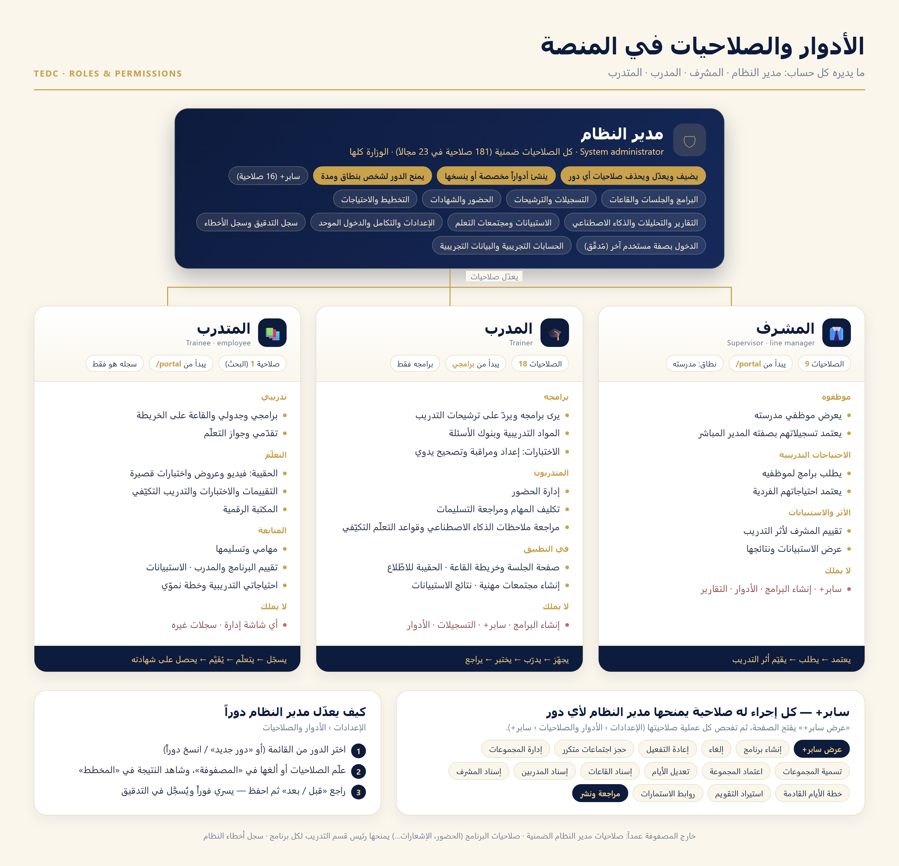
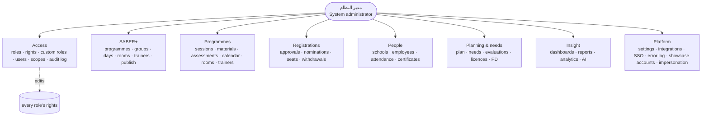
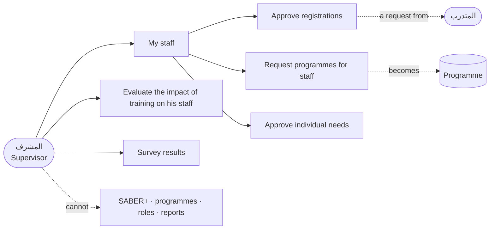
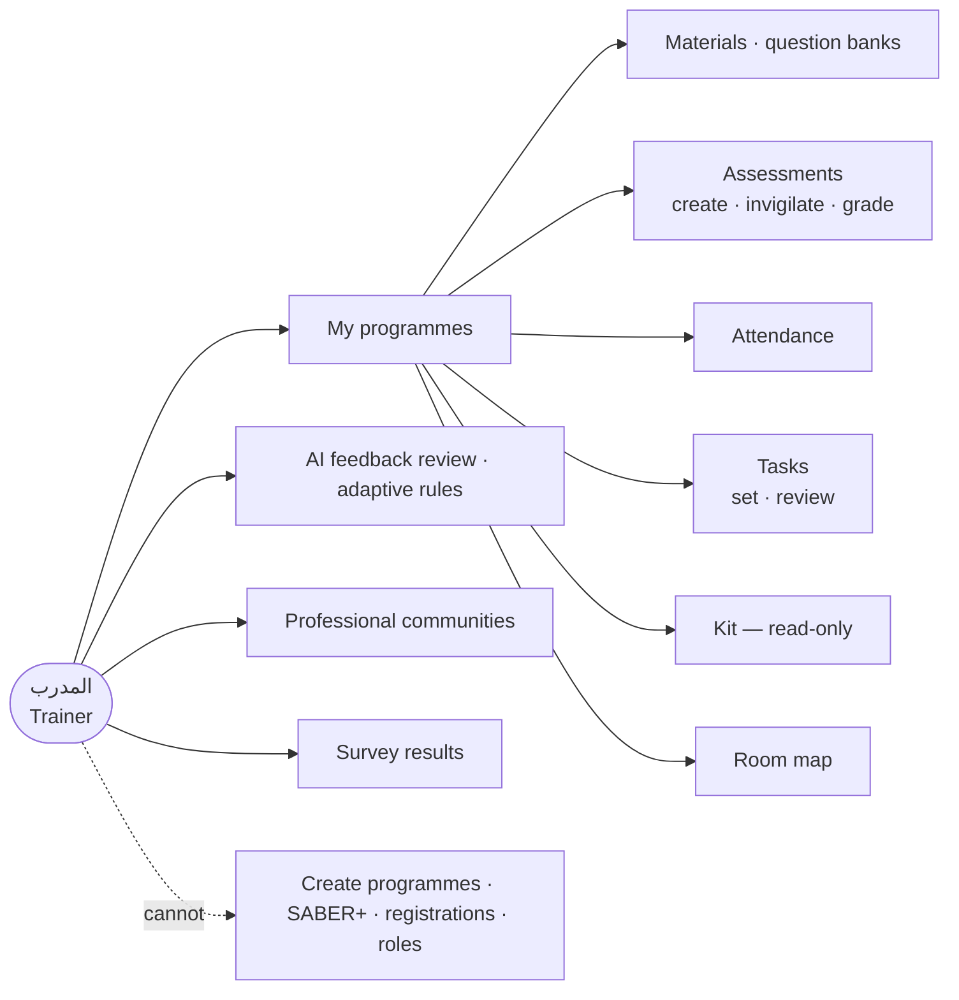
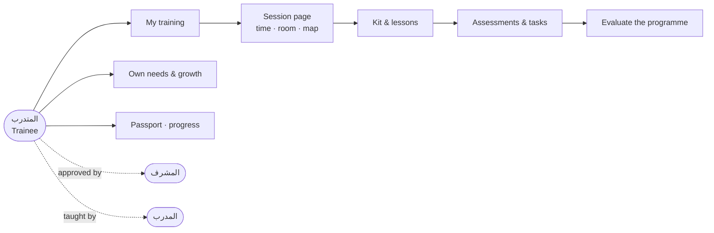
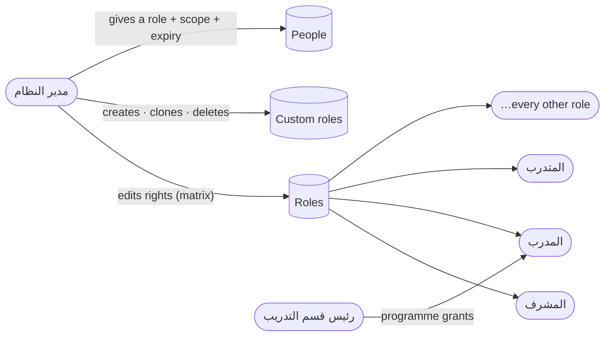

# Roles — what each showcase account can manage

The four showcase accounts (Settings → Showcase accounts) each hold one role. This page says what that role can do, and how the system administrator changes it.

| Account (Arabic) | Role (slug) | Lands on | Rights in the catalogue |
|---|---|---|---|
| مدير النظام | `super_admin` | `/admin` | all — implicit, cannot be edited |
| المشرف | `supervisor` (+ `employee`) | `/portal` | 9 |
| المدرب | `trainer` (+ `employee`) | `/admin/programs` | 18 |
| المتدرب | `employee` | `/portal` | 1 — the rest is *own-record* self-service |

> **Supervisor vs training supervisor.** المشرف (`supervisor`) is the school/department line manager who approves his own staff's training. مشرف التدريب (`program_coordinator`, 21 rights) is a centre role that runs programmes. The showcase "المشرف" is the first.

A *right* is a row of `RolePermissionSeeder::PERMISSIONS` (181 of them, in 23 areas). A route checks it with `permission:<slug>`; the web and the app hide what the signed-in user lacks. The system administrator is the only role that passes every check without holding the rights.

## How the system administrator changes any role

**Settings → Roles & permissions** (`/admin/settings?tab=roles`).

- **Edit** — pick a role (system roles included, except the system administrator's own), tick or untick rights in the **Matrix** tab, review the *before / after* list, save. Takes effect on the holder's next request. Audited (`permissions_changed`).
- **See** — the **Diagram** tab draws the same role as a map of areas with the open rights listed; it follows unsaved ticks.
- **Add** — *New role* (blank, or a copy of any role), with allowed scopes (ministry / school group / school / department) and a landing page. Audited (`role_created`).
- **Delete** — custom roles with no holder. System roles cannot be deleted. Audited (`role_deleted`).
- **Give a role to a person** — Users → the person → *Roles*, with a scope and optional expiry. Only the system administrator can hand out `super_admin`.
- **SABER+** — its 16 rights are the **سابر+** area of the matrix (`saber.view` opens the page; every action then checks its own right: create, cancel, reactivate, groups, days, rooms, trainers, supervisor, plan, import, survey links, publish). Tick any of them for any role. Test: `RolesCatalogueTest::test_the_super_administrator_grants_and_revokes_saber_rights_and_they_take_effect`.

`RolesCatalogueTest` also fails the build if a route or controller enforces a right that is not in the catalogue, so nothing the system checks can be out of the administrator's reach.

### Four things the matrix does not change (on purpose)

1. **The system administrator's rights** are implicit (`*`). An empty list would not lock the account out.
2. **Programme grants** — `attendance.mark`, `notifications.send`, `kits.assign`, `tasks.review` — are given *per programme* by the training head (Programme → Rights), not by a role, so a trainer can mark attendance in one programme only.
3. **The system error log** (`logs.manage`) is kept out of the catalogue by design: only the system administrator can open it.
4. **A few actions are tied to the role itself**, not a right: signing in as another user and handing out `super_admin` (system administrator only); loading demo data and the data-import console (system administrator only); school administrators' own-school screens; the centre-staff data scope (`CENTER_STAFF` roles see Ministry-wide data); trainers see only programmes they teach.

## 1. مدير النظام — System administrator

Everything, Ministry-wide. On top of every area below it alone can: change roles and rights, create custom roles, give `super_admin`, sign in as another user (audited), load/clear demo data, run imports, and manage the showcase accounts.

## 2. المشرف — Supervisor (line manager)

Lands on the portal. Sees his own staff and approves their training. No admin dashboard.

| Area | Can |
|---|---|
| Staff | view the employees of his school (`employees.view`) |
| Registrations | approve his staff's registrations as direct manager (`registrations.approve_manager`) |
| Needs | request programmes for staff (`needs.request`); approve their individual needs (`needs.approve_individual`) |
| Impact | view impact, give the supervisor's evaluation (`impact.view`, `impact.supervise`) |
| Surveys | see surveys and their results (`surveys.view`, `surveys.results`) |
| Search | global search |

## 3. المدرب — Trainer

Lands on **My programmes**. Sees only programmes he teaches.

| Area | Can |
|---|---|
| Programmes | view his programmes; answer training proposals; manage materials, question banks and assessments; grade and invigilate (`programs.view`, `trainers.respond`, `materials.manage`, `banks.manage`, `assessments.manage/grade/invigilate`) |
| Attendance | manage attendance (`attendance.manage`) |
| Tasks | set tasks and review submissions (`tasks.manage`, `tasks.review`) |
| Learning | review AI feedback drafts; adaptive-learning rules (`ai.feedback.review`, `adaptive.manage`) |
| Communities | create professional communities; see PLC workshops (`communities.create`, `plc.view`) |
| Surveys / library / search | survey results; digital library; global search |
| App | the session page with the room map, the programme kit (read-only), attendance |

## 4. المتدرب — Trainee

Holds the `employee` role: one catalogue right (global search). Everything else is *about his own record*, so it needs no right.

| Area | Can |
|---|---|
| My training | his programmes, schedule and the room on the map; progress and the learning passport (`MyTraining`, `MyProgress`, `Passport`) |
| Learning | open the kit (video, slides, quiz…), assessments and exams, adaptive practice, the digital library (`Learn`, `Assessments`, `Library`) |
| Tasks | see and submit tasks (`MyTasks`) |
| Feedback | evaluate a programme and its trainer, answer surveys (`MyEvaluations`, `Surveys`) |
| Needs & growth | his own training needs and growth plan (`MyNeeds`, `MyGrowth`) |
| Account | notifications, orders and wallet, privacy requests |

## Who edits whom

The role/right counts above are read from the seeded catalogue; re-check them after a change with `php artisan test --filter=RolesCatalogueTest`.
